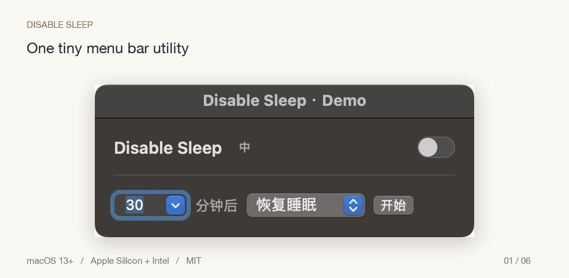

<div align="center">
  
  <h1>LidOff</h1>
  <p><strong>在菜单栏点一下，就能让 Mac 合盖后继续运行，不用反复输入终端命令。</strong></p>
  <p><a href="https://kuisxuked.github.io/lidoff/">项目主页</a> · <a href="https://github.com/kuisxuked/lidoff/releases/latest">下载 macOS 版</a> · <a href="README.md">English</a></p>
  
  <p><sub>演示录制自应用的真实原生界面，使用独立演示模式，不修改演示电脑的电源设置。</sub></p>
</div>

> **开发预览 · 1.5.0 尚未发布。** 本文描述即将发布的 LidOff；旧发布版可能仍用原名，且不包含新增安全、屏幕和闲置锁屏控制。可自行构建当前源码体验，并在 Releases 中确认下载版本。

## 小巧，但够用

| 功能 | 用法 |
| --- | --- |
| 合盖继续运行 | 顶栏图标 → **LidOff** 开关 |
| 定时开启或关闭 | 选择分钟数与操作，点「开始」，随时可取消 |
| 一直保持唤醒 | 时间选「永不」，点「开启」，仍受电量、温度、崩溃和退出保护限制 |
| 中英文切换 | 标题旁很小的 **中 / EN** 按钮 |
| 避开摄像头刘海 | 默认放在右侧，可按住 Command 拖动 |
| 后续开关免密 | 首次授权一次，只放行两条固定命令 |

## 为什么选择 LidOff？

LidOff 使用 `pmset disablesleep` 处理合盖运行。[KeepingYouAwake](https://github.com/newmarcel/KeepingYouAwake) 基于 `caffeinate`，明确说明不支持合盖；具体合盖行为仍须在自己的 Mac 型号和系统版本上验证。

适合下载、上传、编译、渲染以及远程连接。建议先使用倒计时和默认 20% 电量保护，并放在通风表面。

## 快速上手（Quick Start）

**1.5.0 发布后：** [下载通用版 ZIP](https://github.com/kuisxuked/lidoff/releases/latest)，解压并打开 **LidOff.app**。支持 **macOS 13+，Apple Silicon 和 Intel**。

该版本发布后，可使用以下 **3 行**及固定名称下载文件：

```sh
curl -fL https://github.com/kuisxuked/lidoff/releases/latest/download/LidOff-macOS-universal.zip -o LidOff.zip
ditto -x -k LidOff.zip .
open "LidOff.app"
```

点顶栏的月亮／太阳图标。首次开关需要管理员授权一次，此后免密。先将应用移至 Applications，再在「选项与安全」中启用「登录时启动」。如 macOS 提示，请允许安全监控后台项目。这些功能及固定文件名下载链接从 v1.5.0 起提供。

> **首次打开：** 此社区版本为本地签名，**没有 Apple 公证**，从网上下载后可能被 macOS 拦截。确认信任来源后，到「系统设置 → 隐私与安全 → 仍要打开」。参见 [Apple 官方说明](https://support.apple.com/guide/mac-help/open-a-mac-app-from-an-unknown-developer-mh40616/mac)，无需全局关闭安全保护。

## 你需要知道的行为

- 开启执行 `pmset -a disablesleep 1`；关闭执行 `pmset -a disablesleep 0`。
- 这是系统级设置，同时影响电池与外接电源，也会禁止闲置睡眠；**退出应用会恢复正常睡眠**。关闭开关只是允许正常睡眠，不会立刻强制休眠；其他程序和 macOS 合盖模式也可能使电脑保持唤醒。合盖运行时请保持通风。
- 「永不」会取消已有倒计时，并一直禁止睡眠，仍受电量、温度、崩溃和退出保护限制。
- 倒计时支持 1–10080 分钟，一次一个。关闭总开关时暂停，重新开启后从剩余时间继续；关闭状态下新建的倒计时也会暂停。重启应用会保留暂停状态与剩余时间。
- 倒计时**不会主动唤醒电脑**。允许睡眠不等于强制立即睡眠。失败的任务可重试，旧版「失败＋暂停」数据会自动修复。
- 「选项与安全」提供「保持屏幕常亮」：仅在禁止睡眠期间持有临时 IOKit 断言，不改动原有屏幕超时；会话或进程结束后自动释放。它不绕过锁屏、不点亮合上的内置屏幕，也不保证所有扩展坞／显示器组合的行为。
- 可选「防止闲置锁屏（实验性）」：会话期间保持屏幕，并每 15 秒报告本地用户活动。不修改显示、屏保或密码／锁屏设置，也不需要辅助功能权限；选项关闭、会话结束或进程退出时停止。不能解锁或覆盖设备管理策略；在依赖此功能前仍需按实际闲置时长测试。
- 默认在电池电量 **≤20%** 时停止，可调整阈值；可选「仅连接电源时运行」和「电池低电量模式时停止」，后者只在使用电池时生效。无法读取电源状态时按保护处理。系统报告严重或临界温度压力时会结束会话。
- 可选全局快捷键 **⌥⌘S**、结束前 1 分钟本地通知、登录时启动，以及应用内修复／移除免密授权。通知受系统权限和专注模式影响。
- 独立的非 root LaunchAgent 每 10 秒检查已保存的会话。倒计时到期、电量／电源／温度触发保护，或应用超过 45 秒没有心跳时，尝试恢复睡眠；崩溃后通常约 45–55 秒。它只能恢复睡眠，不能开启禁止睡眠。恢复失败会保留任务并重试，应用也会检查监控健康状态。
- 「永不」只取消倒计时，安全保护仍然生效。退出或崩溃恢复后不会在重启应用时静默重建会话。此用户级监控仅在登录期间运行；退出登录后会在下次登录时处理遗留会话；电脑睡着时要等唤醒才能检查。权限被撤销或后台项目被禁用都可能阻止恢复，不是硬件安全保证。详情见 [SECURITY.md](SECURITY.md)。

## 自动化

可在快捷指令的「运行 Shell 脚本」中调用：

```sh
"/Applications/LidOff.app/Contents/MacOS/LidOff" --on --minutes 30
"/Applications/LidOff.app/Contents/MacOS/LidOff" --off
"/Applications/LidOff.app/Contents/MacOS/LidOff" --status
```

另支持 `--toggle`、`--on`（无倒计时）、`--show`、`--quit`、`--help`。操作交给正在运行的应用，保留相同的授权说明和安全保护；`--status` 仅读取。命令转交成功不代表异步操作已完成，可查看面板或读取状态；应用忙碌时需要重试。

## 权限与隐私

首次设置会在 `/private/etc/sudoers.d/lidoff-<当前 UID>` 写入一个由 root 拥有、权限 `0440` 的文件，只允许当前用户免密执行：

```text
/usr/bin/pmset -a disablesleep 0
/usr/bin/pmset -a disablesleep 1
```

不放行其他参数、Shell 或任意 `sudo`。同一用户运行的其他程序也可以执行这两条命令。程序不保存密码、不安装常驻 root 服务、不收集分析数据、不上传电源设置。首次操作会先显示双语权限说明；后台安全监控以当前用户运行。开启会话前用 `sudo -l` 检查两条命令的实际权限，可在选项中修复授权。安装前后均使用 `visudo` 校验，不修改主 sudoers 文件；需要系统保留默认的 `sudoers.d` 引用。

## 自行构建

安装 Apple Command Line Tools 后：

```sh
git clone https://github.com/kuisxuked/lidoff.git && cd lidoff
./build.sh && ./test.sh
open "LidOff.app"
```

可在 Xcode 中打开 `Package.swift` 浏览和调试源码；完整应用及监控由 `build.sh` 打包。`./release.sh` 会先跑测试，再构建 Intel + Apple Silicon 通用版，启用 hardened runtime，生成 ZIP、`SHA256SUMS.txt` 和带校验值的 Homebrew cask。下载后可用 `shasum -a 256 -c SHA256SUMS.txt` 校验。测试不改动系统电源设置；具体合盖行为仍需在自己的硬件上验证。

## 从旧名称升级

先退出旧版应用，再打开 LidOff。LidOff 会一次性迁移语言、倒计时和其他偏好，不覆盖已有 LidOff 设置。下次授权会替换带本应用标记的旧 sudoers 规则；开启会话前先恢复正常睡眠，再移除旧监控。清理失败会中止新会话，避免两个监控同时运行。升级后删除旧应用及其系统登录项，按需重新启用 LidOff 登录项。新 bundle identifier 可能需要重新允许权限。

## 分发与卸载

标签发布工作流会生成 GitHub 构建来源证明并准备草稿发布。维护者提供 Developer ID 和凭据后，可启用签名和公证；默认社区构建仍为 ad-hoc 签名、未公证。生成的 `dist/lidoff.rb` 可用于维护者的 Homebrew tap，不表示已进入官方仓库或已发布 tap。Sparkle、校验客户端签名的特权 helper 和复杂触发／日程功能留待后续独立设计。见 [分发说明](docs/DISTRIBUTION.md)。

卸载时使用「**选项与安全 → 移除授权并退出**」，管理员操作会先恢复睡眠，再删除本应用标记的 sudoers 规则、移除登录项及安全监控；之后删除应用。

若 UI 无法使用，手动恢复和清理：

```sh
sudo /usr/bin/pmset -a disablesleep 0
sudo rm -f "/private/etc/sudoers.d/lidoff-$(id -u)"
launchctl bootout "gui/$(id -u)/local.lidoff.watchdog"
rm -f "$HOME/Library/LaunchAgents/local.lidoff.watchdog.plist"
rm -rf "$HOME/Library/Application Support/LidOff"
```

如有需要，在系统设置中移除应用的登录项。仅删除应用仍会留下免密规则与监控副本；监控会在下次运行时尝试恢复睡眠。贡献、版本记录和安全问题请参见 [CONTRIBUTING.md](CONTRIBUTING.md)、[CHANGELOG.md](CHANGELOG.md)、[SECURITY.md](SECURITY.md)。

## 分享与反馈

把[项目主页](https://kuisxuked.github.io/lidoff/)或[下载链接](https://github.com/kuisxuked/lidoff/releases/latest)发给朋友即可。[反馈问题](https://github.com/kuisxuked/lidoff/issues)时请附上 macOS 版本和 Mac 型号，勿上传密码或私人日志。

MIT 开源许可 · [kuisxuked](https://github.com/kuisxuked)
